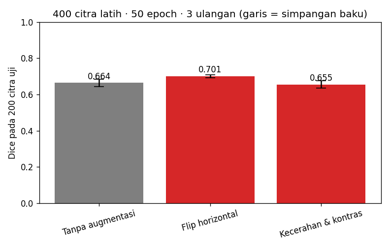
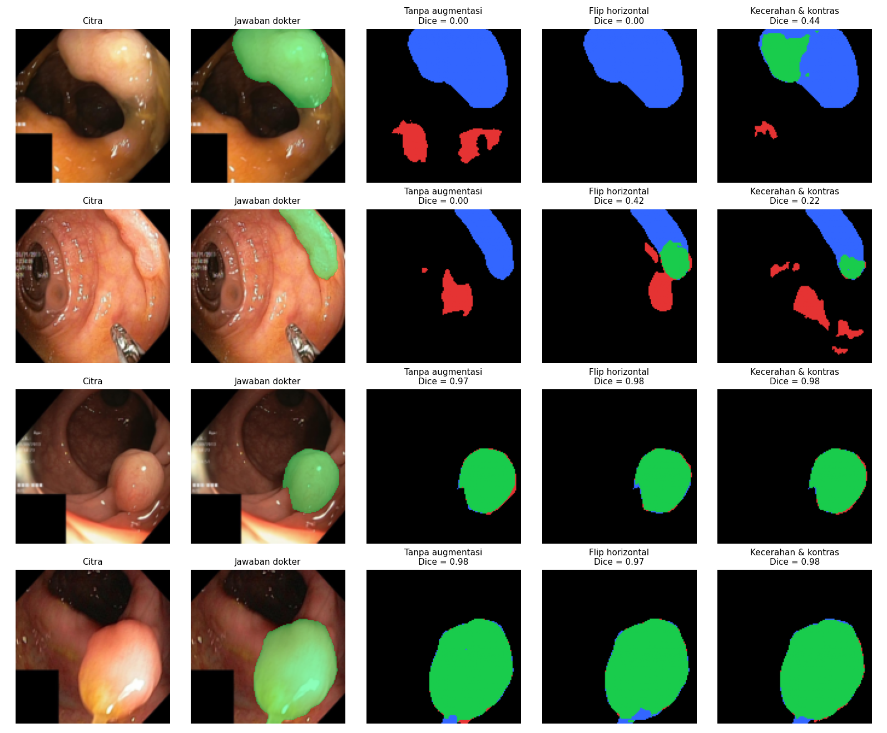

# Segmentasi Polip pada Citra Kolonoskopi dengan U-Net

<!--
  TEMPLATE LAPORAN — Tugas P10 Kecerdasan Buatan (BM25-41204), Teknik Biomedis ITERA.
  Petunjuk lengkap: https://mctm.web.id/ai-bm/tugas

  Cara memakai:
  - Ganti semua teks yang diawali "✍️" dengan tulisan kelompokmu, lalu hapus tanda ✍️-nya.
  - Blok komentar seperti ini adalah petunjuk; tidak tampil di GitHub. Boleh dihapus.
  - Gambar diambil dari folder hasil/ yang dibuat otomatis oleh notebook.
  - Jangan hapus judul-judul bagian (##).
-->

**Tugas P10 — Kecerdasan Buatan (BM25-41204), Teknik Biomedis ITERA**

## Anggota kelompok

| Nama | NIM | Username GitHub | Kontribusi utama |
|Cecilia Hazel Kersten Ginting | 12343010 | cecilia123430105 | Ketua kelompok, koordinasi, dan pengelolaan repository |
| Mutiarasari Lilinantri Nainggolan | 123430123 | nainggolanmutiara23-coder | Persiapan eksperimen, pengujian skenario augmentasi, dan analisis hasil |

## 1. Pertanyaan

Augmentasi apa yang membantu U-Net menemukan polip pada citra kolonoskopi, dan augmentasi apa yang tidak? Kenapa?

## 2. Data & pengaturan

<!-- Isi dari Bagian 2 notebook. Pastikan CEPAT = False untuk hasil akhir. -->

- Dataset: Kvasir-SEG (1000 citra kolonoskopi + mask polip), diperkecil ke 128 × 128 piksel.
- Data uji: 200 citra (tetap). Data latih: 400 citra per ulangan.
- Model: U-Net mini (±0,5 juta parameter), 50 epoch, 3 ulangan per skenario.
- Batch size: 16
- Learning rate: 0.00005
- Dijalankan di: Google Colab dengan GPU T4 


## 3. Skenario augmentasi & hipotesis

<!-- Tulis bagian ini SEBELUM menjalankan eksperimen. Commit dulu, baru jalankan.
     Alasan klinis = kenapa variasi ini mungkin (atau tidak mungkin) terjadi pada kolonoskopi sungguhan. -->

| Skenario | Augmentasi (kode) | Alasan klinis | Hipotesis: Dice naik/turun/sama? |
|---|---|---|---|
| Tanpa augmentasi | — | Digunakan sebagai pembanding tanpa transformasi citra. | Acuan |
| Flip horizontal | `v2.RandomHorizontalFlip(p=0.5)` | Orientasi horizontal citra dapat bervariasi selama pemeriksaan kolonoskopi. | Dice diperkirakan naik |
| Kecerahan & kontras | `v2.ColorJitter(brightness=0.3, contrast=0.3)` | Intensitas pencahayaan dan kontras citra dapat berbeda selama pemeriksaan kolonoskopi. | Dice diperkirakan naik |

Contoh augmentasi yang dicoba:


<!-- Ganti nama file sesuai skenario kalian (lihat isi folder hasil/). -->

## 4. Hasil

<!-- Tempel isi hasil/ringkasan.md di sini. -->

✍️ tempel tabel dari `hasil/ringkasan.md`



## 5. Analisis peta kesalahan



<!-- Hijau = benar, merah = false positive, biru = false negative.
     Pertanyaan pemandu: Polip seperti apa yang sering terlewat (kecil? datar? warna mirip dinding usus?)
     Apa yang sering dikira polip padahal bukan? Apakah augmentasi memperbaiki kasus sulit? -->

✍️ Peta kesalahan digunakan untuk melihat kesesuaian hasil prediksi model dengan mask referensi pada citra uji. Visualisai ini membantu mengidentifikasi bagian polip yang berhasil dikenali maupun bagian yang masih mengalami kesalahan segmentasi. Interpretasi peta kesalahan dilakukan dengan memperhatikan: 
- Area prediksi yang sesuai dengan mask referensi.
- Area yang terdeteksi sebagai polip oleh model, tetapi tidak termasuk dalam mask referensi
- Area polip pada mask referensi yang tidak berhasil dikenali model 

## 6. Pembahasan & kesimpulan

<!-- Bandingkan hasil dengan hipotesis di Bagian 3. Hipotesis yang ternyata salah tetap bernilai,
     asalkan dijelaskan kenapa. Perbedaan kecil (lebih kecil dari simpangan baku) belum tentu berarti. -->

✍️ Berdasarkan hasil eksperimen, skenario flip horizontal memperoleh performa terbaik dengan rata-rata Dice sebesar 0.701 dan IoU sebesar 0.597. Nilai tersebut lebih tinggi dibandingkan skenario tanpa augmentasi yang memperoleh rata-rata Dice 0.664 dan IoU 0.557.

Hasil ini menunjukkan bahwa penerapan flip horizontal membantu meningkatkan kemampuan model U-Net dalam melakukan segmentasi polip pada dataset yang digunakan. Selain memperoleh nilai rata-rata tertinggi, skenario ini juga menunjukkan variasi hasil antarulangan yang relatif kecil.

Sebaliknya, augmentasi kecerahan dan kontras memperoleh rata-rata Dice sebesar 0.656 dan IoU sebesar 0.543. Hasil tersebut lebih rendah dibandingkan skenario tanpa augmentasi. Dengan demikian, hipotesis bahwa perubahan kecerahan dan kontras akan meningkatkan performa model tidak terbukti pada konfigurasi eksperimen ini.

Secara keseluruhan, flip horizontal menjadi skenario augmentasi dengan performa terbaik dalam eksperimen ini. Sementara itu, perubahan kecerahan dan kontras belum memberikan peningkatan performa segmentasi. Hasil ini menunjukkan bahwa pengaruh augmentasi terhadap model bergantung pada jenis transformasi yang diterapkan dan karakteristik dataset yang digunakan.

## 7. Pembagian kerja

<!-- Siapa mengerjakan apa. Penilaian proses kerja dilihat dari riwayat commit tiap anggota. -->

- Cecilia Hazel Kersten Ginting: Koordinasi kelompok, pengelolaan repository, dan penyusunan laporan.
- Mutiarasari Lilinantri Nainggolan: Persiapan notebook, pengujian skenario augmentasi, serta analisis hasil eksperimen.

## 8. Penggunaan AI

<!-- Wajib diisi, walau tidak memakai AI (tulis "Tidak memakai AI").
     Contoh: "Claude Code (CLI) untuk menulis skenario augmentasi dan memperbaiki error di Bagian 4.
     Draf Bagian 6 ditulis sendiri, lalu dirapikan bahasanya dengan bantuan AI." -->

ChatGPT digunakan untuk membantu memahami alur kode notebook, mengidentifikasi dan memperbaiki error saat menjalankan program, serta menyusun alternatif skenario augmentasi dan hipotesis awal. Eksperimen dan pengambilan hasil dilakukan melalui Google Colab.

## Cara menjalankan ulang

```bash
uv sync
uv run jupyter lab segmentasi_polip.ipynb
```

Atau buka notebook di Google Colab (Runtime → Change runtime type → T4 GPU).

## Referensi

- Jha, D., dkk. (2020). Kvasir-SEG: A Segmented Polyp Dataset. *MultiMedia Modeling (MMM 2020)*, 451–462.
- Ronneberger, O., Fischer, P., & Brox, T. (2015). U-Net: Convolutional Networks for Biomedical Image Segmentation. *MICCAI*. arXiv:1505.04597.
- ✍️ tambahkan referensi lain yang kalian pakai
- Sánchez-Peralta, L. F., Picón, A., Sánchez-Margallo, F. M., dkk. (2020). Unravelling the effect of data augmentation transformations in polyp segmentation. *International Journal of Computer Assisted Radiology and Surgery, 15*, 1975–1988.